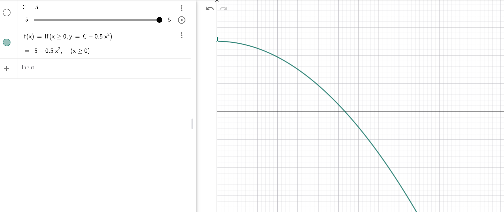
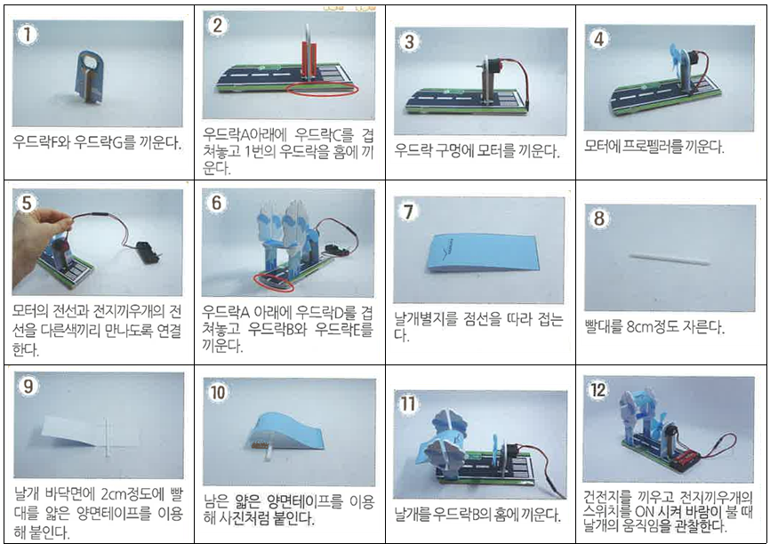
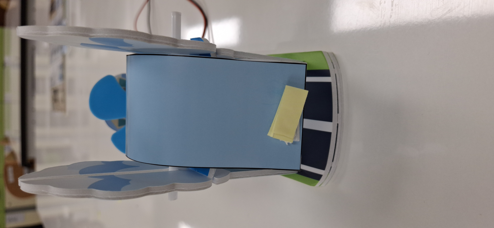
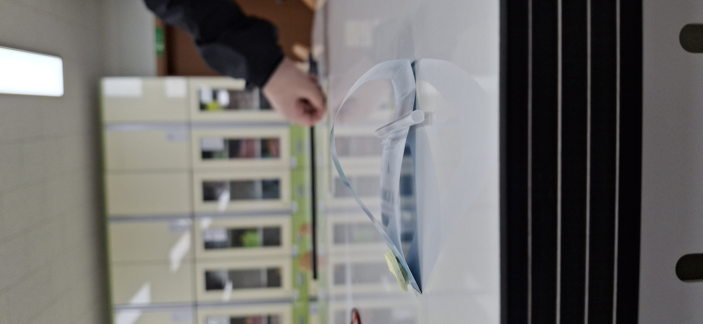

# 서론

## 가. 탐구의 필요성 (동기) 및 목적
거대한 비행기가 공중에 뜨는 원리와 날아가는 공이 휘어지는 현상에 대한 호기심에서 출발하여, 이를 설명하는 유체역학적 원리를 직접 확인하고 이해하고자 탐구를 진행하였다.

## 나. 이론적 배경
베르누이 원리란 유체의 흐름이 빠른 곳에서는 압력이 낮아지고, 유체의 흐름이 느린 곳에서는 압력이 높아진다는 원리이다. 이는 다음과 같은 방정식으로 기술된다.

$$P + \frac{1}{2}\rho v^2 + \rho gh = \text{constant}$$

$$\begin{aligned} \rho &: \text{유체의 밀도 } (\mathrm{kg/m^3}) \\ g &: \text{중력 가속도 } (\mathrm{m/s^2}) \\ h &: \text{기준면으로부터의 높이 } (\mathrm{m}) \end{aligned}$$

이때 유체의 밀도($\rho$)와 높이($h$)의 변화가 일정하다고 가정하면, 베르누이 방정식은 다음과 같이 간소화된다.

$$P + \frac{1}{2}\rho v^2 = \text{constant} \quad (\because \rho, g, h \text{ 일정})$$

이 식은 전체 에너지가 일정할 때, 유체의 속도($v$)가 증가할수록 내부 압력($P$)은 감소한다는 사실을 보여준다.

다음은 $\rho, g, h$가 일정하다는 가정하에 속도($v$, x축)와 압력($P$, y축)의 관계를 나타낸 그래프이다.

그래프에서 $v$가 충분히 커지면 $P$가 음수(-) 값을 가지는 것을 볼 수 있는데, 이는 절대압력이 음수라는 의미가 아니라 대기압을 기준(0)으로 한 상대적 압력인 게이지 압력(Gauge Pressure)이 음수(저기압)가 됨을 의미한다.

---

# 탐구활동

## 가. 탐구기간
9월

## 나. 탐구장소
문수중학교 과학실

## 다. 탐구주제
베르누이 원리를 활용하여 비행기 날개에 양력이 발생하는 원리 탐구

## 라. 탐구과정
1. 제공된 교구 키트의 안내에 따라 순서대로 실험 모형을 제작하였다.

2. 초기 조립 후 날개가 너무 가벼워 공중에서 균형을 잡지 못하는 현상이 발생하였다. 이를 해결하기 위해 날개 뒷부분에 양면테이프를 추가로 붙여 무게중심을 뒤쪽으로 이동시켰으며, 그 결과 공중에서 안정적인 자세를 유지할 수 있었다.

3. 제작된 날개의 단면을 측면에서 관찰하면 위쪽이 아래쪽보다 볼록한 유선형 구조를 이룬다. 이 구조로 인해 날개 위쪽을 지나는 공기의 흐름이 아래쪽보다 빨라진다. 베르누이 원리에 따라 위쪽에는 저기압, 아래쪽에는 상대적으로 고기압이 형성되어 날개를 위로 밀어 올리는 양력이 발생한다.

## 마. 탐구결과
바람을 가해주었을 때, 베르누이 원리에 의해 형성된 기압 차로 비행기 날개가 위로 떠오르는 것을 확인하였다.

[작동 동영상 보기](https://drive.proton.me/urls/87DBGSMDTW#66h6eMWsj6td)
*(참고: 링크 접속이 불가할 경우 `Assets/working.mp4` 파일 참조 / 종단간 암호화(E2EE) 적용으로 로딩에 시간이 소요될 수 있음)*

---

# 결론 및 전망

## 가. 결론
유선형 구조를 가진 비행기 날개는 위아래 공기 흐름의 속도 차이를 만들어내며, 베르누이 원리에 의해 발생하는 위아래의 압력차(양력)로 인해 위로 떠오를 수 있음을 실증하였다.

## 나. 전망 및 향후 과제
본 실험 결과를 바탕으로 컴퓨터 유체역학(CFD) 시뮬레이션을 수행하여, 실제 공기 흐름 모형과 실험 결과 간의 유사점 및 차이점을 구체적으로 비교·분석해 볼 수 있을 것이다.

## 다. 느낀점
비행기가 공중을 나는 것이 당연하다고 생각했으나, 그 이면에 정밀한 유체역학적 원리가 숨겨져 있다는 사실을 깨달으며 과학적 탐구의 흥미와 재미를 느낄 수 있었다.

# 참고 문헌 및 출처
* 사용 키트: 베르누이 원리 키트 제조사